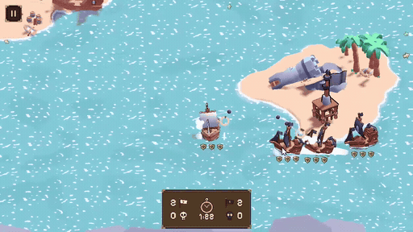
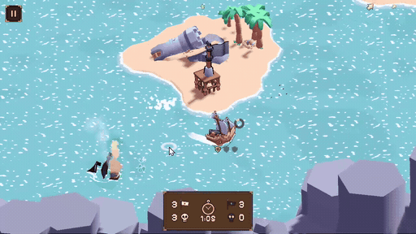

# Ship Game

A small 3D top-down pirate ship game made with Godot 4. Sail around, fight enemy ships with cannons, and capture islands to score points.





## Features

- **Naval combat:** Aim and fire cannon balls, lead your shots, and sink enemy ships.
- **Dynamic split screen:** Play with a friend on one screen — camera stays shared when you are close and smoothly splits apart when you separate.
- **Island capture:** Sail into enemy island zones and hold them to raise your flag and rack up points.
- **AI ships:** Bot-controlled ships that patrol, chase, and engage in firefights.
- **Controller support:** Full support for keyboard, mouse, and gamepads.

## Controls

### Player 1
- **Move / Steer:** `WASD` or Arrow keys (Left stick on gamepad)
- **Shoot:** `Space` or Left Click (`RT` / `A` on gamepad)
- **Aim Radius:** `Q` / `E` (`LB` / `RB` on gamepad)
- **Aim:** Mouse cursor (Right stick on gamepad)

### Player 2 (Local Co-op / Gamepad)
- **Move / Steer:** Left stick / D-Pad
- **Shoot:** `RT` / `A` button
- **Aim Radius:** `LB` / `RB`
- **Aim:** Right stick

## Getting Started

1. Clone or download the repository:
   ```bash
   git clone https://github.com/your-username/Godot-Ship-Game.git
   ```
2. Open **Godot 4** and import `project.godot`.
3. Press **F5** to run the game (`res://scenes/main.tscn`).
